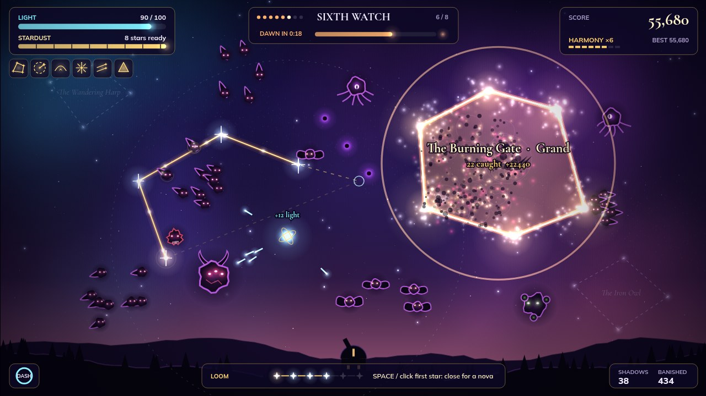

# STARLOOM

[](https://make.fun/bounty/best-game-01?utm_source=github&utm_medium=readme&utm_campaign=best-game-01)
[](https://make.fun/bounty/best-game-01/leaderboard?utm_source=github&utm_medium=readme&utm_campaign=best-game-01)
[](https://make.fun/bounty/best-game-01?utm_source=github&utm_medium=readme&utm_campaign=best-game-01)

An entry in the make.fun bounty [best-game-01: Make the best game](https://make.fun/bounty/best-game-01).

**Pin stars to the night. Spin burning silk. Close the shape, and the dark burns.**

STARLOOM is a run-based action-strategy game for the browser. You are the Weaver, a small
comet-spirit holding the sky above an old observatory through one long night. The shadows come
in from the edges. You fight them by drawing constellations.



## How it plays

- **Pin stars.** Click within the Weaver's reach to pin a star. Each one costs stardust and is
  spun to the last by a thread of burning silk. Any shadow that crosses silk burns and slows.
- **Close the shape.** Click the first star again, or press Space. The chain ignites as a
  constellation and a **nova** strikes every shadow inside it. More stars, a bigger shape and a
  fuller net all hit harder. A net of three or more raises your **Harmony** score multiplier.
  Close a shape that uses every star slot and it's a **Grand Constellation**, with a third more power.
  A big catch gives back some light. Getting hurt resets Harmony.
- **Hold until dawn.** Each of the eight watches brings something new: wisps that swarm,
  flitters that weave, gnawers that eat your stars, Umbral Hulks that snap silk, lurkers that spit
  orbs from afar, and mires that burst into wisps. Hold a watch until the dawn bell and the loom
  deals you three **boons**. You keep one (14 boons, each with several levels).
- **Bind the Eclipse.** The Last Watch brings the Eclipse. Bolts barely scratch it and silk only
  singes it, so you have to wrap it in constellations while it rings the sky with orbs and calls
  the swarm.

Your best score, deepest watch and dawns seen are saved in your browser. The settings (master,
music and effects volume, screen shake, mute) are saved too.

## Controls

| Input | Action |
| --- | --- |
| WASD / arrow keys | fly the Weaver |
| Left click | pin a star (or close, on the first star) |
| Space / E | close the shape: nova |
| Right click / Q | unravel the open chain (half the stardust back) |
| Shift | dash (brief invulnerability) |
| 1 / 2 / 3 or click | choose a boon |
| Esc / P | pause (resume, settings, restart, quit) |
| M | mute |

## Run it

```sh
node serve.ts          # serves game/ on http://localhost:8080
```

There is no build step and the game makes no network requests. Everything is drawn on a 2D
canvas by the game's own code, and every sound and the music are synthesised with WebAudio.

`?seed=N` replays the same night. `?shot=cover|title|boons|boss|victory&seed=1` stages the
deterministic scenes the screenshots in `screenshots/` were taken from (listed in `shots.json`).

## Hand-in

```sh
mkdir -p out && MAKEFUN_OUTPUT_DIR=out node main.ts
```

`main.ts` copies `game/` and `screenshots/` and writes `dossier.json` with the kit's unchanged
`vendor/makefun-game.ts`.

## Source map

| File | Job |
| --- | --- |
| `game/src/main.js` | boot, the fixed-step loop, screens and input routing |
| `game/src/world.js` | the run: phases, contacts, damage, dawn bell, boons, victory and defeat |
| `game/src/loom.js` | stars, silk threads, closing constellations and novas |
| `game/src/weaver.js` | the player: flight, dash, starbolts, stardust |
| `game/src/shadows.js` | each shadow's behaviour, including the Eclipse |
| `game/src/waves.js` | the eight watches and the spawn director |
| `game/src/boons.js` | the 14 boons and the stats they derive |
| `game/src/render.js`, `sky.js`, `sprites.js`, `glyphs.js` | drawing the night |
| `game/src/hud.js`, `screens.js` | HUD, title, pause, settings, boon choice, results |
| `game/src/audio.js` | synthesised sound effects and generative music |
| `game/src/effects.js` | particles, rings, popups, shake and flashes |
| `game/src/shots.js` | deterministic screenshot scenes |

## License

MIT, see [LICENSE](LICENSE).
